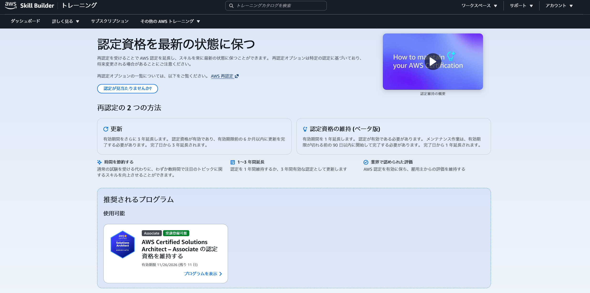
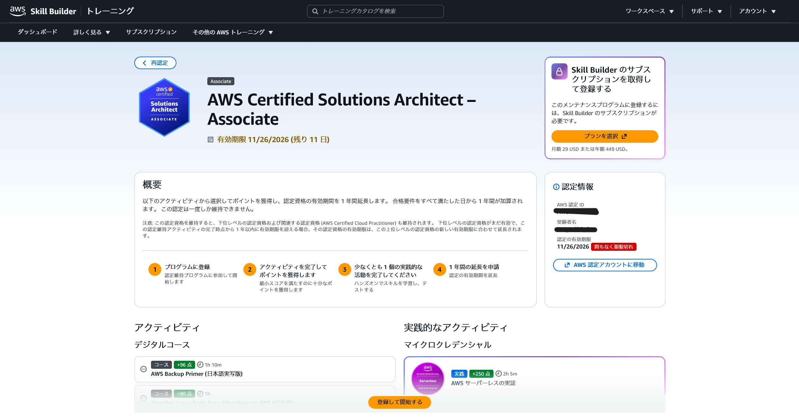
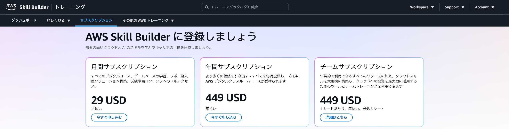
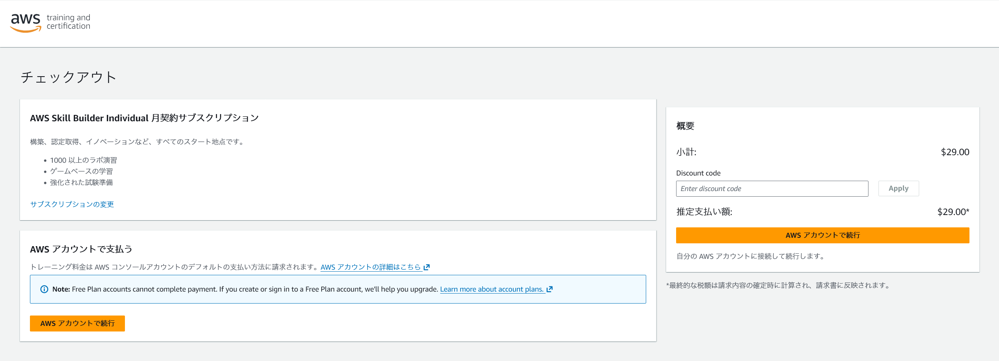
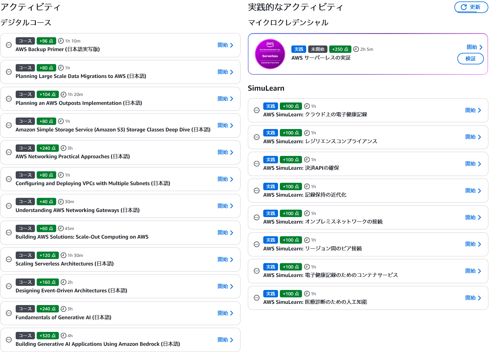
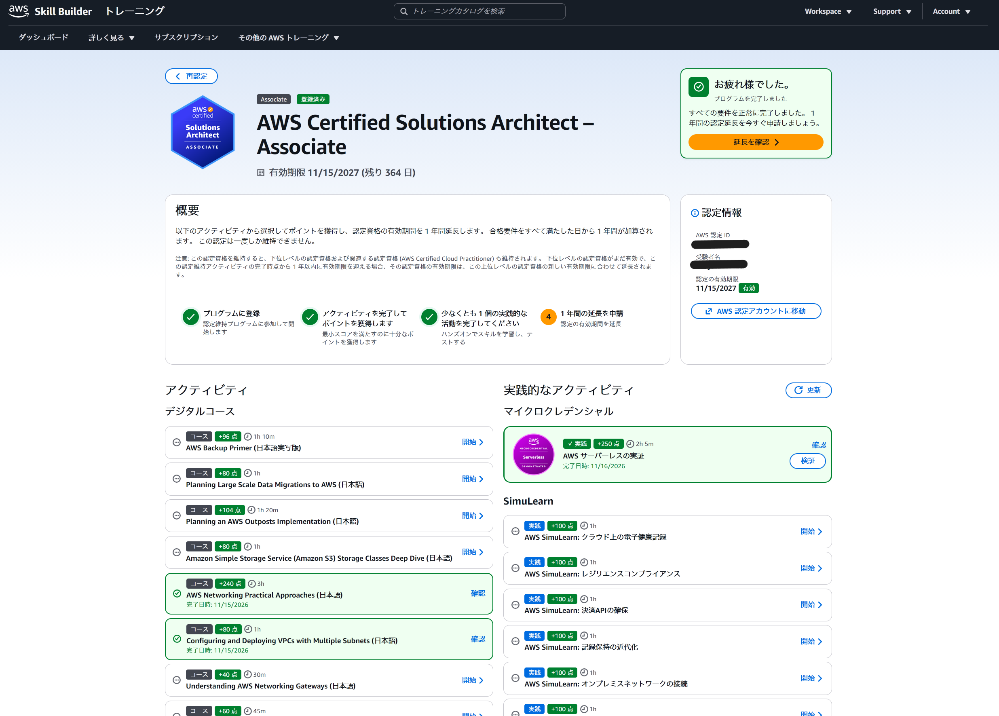

AWS 認定の有効期限はだいたい 3 年です．[私が AWS SAA に合格してから](https://blog.jsmz.dev/blog/2023/aws-saa-testimonial/) 3 年が経とうとしており，せっかく取ったのに失効させるのはもったいないので更新することにしました．

[AWS 認定の再認定ページ](https://aws.amazon.com/jp/certification/recertification/)によると，更新方法は次の 3 つです．

| 方法                                                     | 延長期間 |
| -------------------------------------------------------- | -------- |
| 同じ試験の最新版に合格する                               | 3 年     |
| AWS Certified Solutions Architect - Professional に合格する | 3 年     |
| AWS Skill Builder で認定を維持する                       | 1 年     |

3 つ目は以前はなかった方法です．延長は 1 年だけですが，試験を受けなくてよいので試してみました．

Skill Builder 上では「認定資格の維持 (ベータ版)」という名前です．有効期限の 90 日前から開始でき，同じ認定に対しては 1 度しか使えません．

## サブスクリプションの購入

認定維持プログラムへの登録には Skill Builder のサブスクリプションが必要です．

料金は月額 29 USD または年額 449 USD です．月額で 3,000 円ちょっとかなと思って支払ったら 5,146 円でした．高い．

チェックアウト画面で「AWS アカウントで続行」を押すと，AWS アカウントのログインページに遷移します．ここでは IAM Identity Center のユーザーは選べず，ルートユーザーか IAM ユーザーでログインする必要がありました．

## アクティビティでポイントを稼ぐ

登録後は，デジタルコースや実践的なアクティビティ (マイクロクレデンシャル，SimuLearn) を完了してポイントを貯めます．最小スコアを満たすことに加えて，実践的なアクティビティを少なくとも 1 つ完了する必要があります．

私は次の 3 つを完了しました．

| アクティビティ                                         | 種類                   | ポイント |
| ------------------------------------------------------ | ---------------------- | -------- |
| AWS Networking Practical Approaches (日本語)           | デジタルコース         | 240      |
| Configuring and Deploying VPCs with Multiple Subnets (日本語) | デジタルコース         | 80       |
| AWS サーバーレスの実証                                 | マイクロクレデンシャル | 250      |

ついでに，AWS サーバーレスの実証を完了したことで Serverless のマイクロクレデンシャルももらえました．制限時間 125 分のところ，60 分ほどで終わりました．
具体的な内容は書くことを禁じられているので形式だけ書きます．各問題には構成図と問題設定が示されており，用意された AWS 環境に入って修正します．修正したら「検証」ボタンを押し，正しく直せたかをチェックします．問題は全部で 7 問でした．

要件を満たすと有効期限が 2026-11-26 から 2027-11-15 に延びました．延長は元の有効期限からではなく完了日から 1 年なので，早く終わらせるとその分だけ損をします．

## サブスクリプションのキャンセル

終わったら[サブスクリプションの管理ページ](https://billing.skillbuilder.aws/subscriptions)からキャンセルしましょう．忘れると翌月も 5,000 円ほど請求されます．キャンセルしても，支払った 1 か月分は期限まで受講できます．
